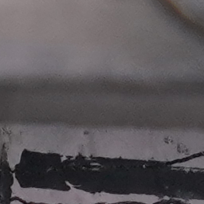

# EfficientSegLite-ECC

Research data and a model checkpoint for crack segmentation and morphological analysis in ECC (Engineered Cementitious Composites), associated with the EfficientSegLite-ECC project.

**Dataset origin:** the data were collected from ECC dog-bone specimens under laboratory conditions.

**Publication status:** the associated manuscript has not yet been published. Paper metadata and a formal citation will be added when available. This release contains data and a checkpoint; model architecture, training code, inference code, and experiment configurations are not included.

## Released materials

All 3,095 source files are retained with their original relative paths and contents (115,077,334 bytes, approximately 109.75 MiB). The manifest and checksum list are additional release documentation.

| Material | Location | Count | Format / dimensions |
| --- | --- | ---: | --- |
| Input images | `dataset/RGB/01` through `15` | 1,440 | RGB PNG, 256 × 256 |
| Segmentation masks | Directly inside `dataset/Label/01` through `15` | 1,444 | Grayscale PNG, 256 × 256 |
| Auxiliary skeleton images | `dataset/Label/13/新建文件夹/` | 105 | Grayscale PNG, 256 × 256 |
| Auxiliary comparison images | `dataset/Label/13/新建文件夹/` | 105 | RGBA PNG, 800 × 400 |
| Model checkpoint | `model_save.pth` | 1 | PyTorch serialized tensor checkpoint, 16,066,450 bytes |

```text
EfficientSegLite-ECC/
├── README.md
├── SHA256SUMS.txt
├── model_save.pth
└── dataset/
    ├── manifest.csv
    ├── RGB/
    │   ├── 01/
    │   │   └── 01_03.png
    │   └── ... 15/
    └── Label/
        ├── 01/
        │   └── 01_03_enhanced.png
        ├── ... 15/
        └── 13/
            └── 新建文件夹/
                ├── 13_01_enhanced_skeleton.png
                └── 13_01_enhanced_compare.png
```

## Image–mask pairing

For an input image at `dataset/RGB/<group>/<name>.png`, its corresponding mask is at `dataset/Label/<group>/<name>_enhanced.png`.

Example:

| Input image | Corresponding mask |
| --- | --- |
|  |  |

Pair by the exact filename stem within the same directory. Do not reconstruct filenames from directory numbers: for example, directory `15` contains filenames with the prefix `16_`. Numeric gaps in filenames are retained.

| Directory | Input images | Direct masks | Matched pairs |
| --- | ---: | ---: | ---: |
| 01 | 88 | 88 | 88 |
| 02 | 97 | 97 | 97 |
| 03 | 90 | 90 | 90 |
| 04 | 98 | 98 | 98 |
| 05 | 77 | 77 | 77 |
| 06 | 59 | 59 | 59 |
| 07 | 104 | 104 | 104 |
| 08 | 104 | 104 | 104 |
| 09 | 68 | 72 | 68 |
| 10 | 68 | 68 | 68 |
| 11 | 118 | 118 | 118 |
| 12 | 105 | 105 | 105 |
| 13 | 105 | 105 | 105 |
| 14 | 126 | 126 | 126 |
| 15 | 133 | 133 | 133 |
| **Total** | **1,440** | **1,444** | **1,440** |

All 1,440 input images have a matching mask. The following four masks have no corresponding input image in this release and are preserved for completeness:

- `dataset/Label/09/09_94_enhanced.png`
- `dataset/Label/09/09_95_enhanced.png`
- `dataset/Label/09/09_96_enhanced.png`
- `dataset/Label/09/09_115_enhanced.png`

The 210 auxiliary files in `dataset/Label/13/新建文件夹/` are skeleton/comparison outputs identified by their filename suffixes. Keep them separate from the direct segmentation masks when constructing image–mask pairs.

## Mask encoding and basic use

The direct masks use black (`0`) for background and white or near-white values (`252`, `253`, `254`, `255`) for the crack foreground. For a binary target, threshold at `> 127`; do not require foreground pixels to equal exactly `255`.

Clone the repository using ordinary Git; Git LFS is not required for this release:

```bash
git clone https://github.com/sherlovk111-cyber/EfficientSegLite-ECC.git
cd EfficientSegLite-ECC
```

The following data-reading example requires Python, Pillow, and NumPy (`python -m pip install pillow numpy`). It does not run the model:

```python
from pathlib import Path
import numpy as np
from PIL import Image

root = Path("dataset")
pairs = []
for image_path in sorted((root / "RGB").glob("*/*.png")):
    group = image_path.parent.name
    mask_path = root / "Label" / group / f"{image_path.stem}_enhanced.png"
    if not mask_path.is_file():
        raise FileNotFoundError(mask_path)
    pairs.append((image_path, mask_path))

assert len(pairs) == 1440
image_path, mask_path = pairs[0]
with Image.open(image_path) as im:
    image = np.asarray(im.convert("RGB"))
with Image.open(mask_path) as im:
    mask = (np.asarray(im.convert("L")) > 127).astype(np.uint8)
assert image.shape[:2] == mask.shape
```

No train/validation/test split is supplied. Directory names are preserved source groups; their exact experimental meaning and specimen mapping are not documented in this release. Define and report any evaluation split explicitly, keeping samples from the same physical specimen together once specimen identities are available.

## Checkpoint and reproducibility

`model_save.pth` is provided unchanged as the available PyTorch checkpoint. Its architecture definition, required PyTorch version, preprocessing/normalization, training schedule, and evaluation settings are not included, so this release alone does not provide an end-to-end reproduction pipeline or verified paper metrics. The checkpoint is not a standalone inference program.

The release does not yet document the loading protocol, acquisition equipment, physical scale, detailed annotation procedure, or specimen-to-directory mapping. Pixel measurements should not be converted to physical crack dimensions without the appropriate calibration.

## File manifest and integrity

[`dataset/manifest.csv`](dataset/manifest.csv) lists all 3,095 source files, including the root checkpoint. Columns are `path`, `bytes`, `sha256`, `role`, `group`, `width`, `height`, `mode`, and `paired_path`. Paths are relative to the repository root. An empty `paired_path` means no direct image–mask pairing is recorded for that file; auxiliary images and the checkpoint have no such pairing.

[`SHA256SUMS.txt`](SHA256SUMS.txt) contains SHA-256 checksums for the same source files. On systems with `sha256sum`, verify from the repository root:

```bash
sha256sum -c SHA256SUMS.txt
```

All released PNGs were decoded successfully during preparation. Every copied source file was checked against the original using SHA-256. These checks establish file integrity and image–mask availability, rather than model performance or annotation accuracy.

## Citation, license, and contact

Until the manuscript is published, reference this repository URL and the specific Git commit used. Formal paper citation information will be added when available.

No license has yet been specified for the data or checkpoint. Please contact the repository maintainer for reuse terms. Questions about the dataset, manuscript, missing metadata, or checkpoint can be raised through [GitHub Issues](https://github.com/sherlovk111-cyber/EfficientSegLite-ECC/issues).

## 中文说明

本仓库公开 EfficientSegLite-ECC 项目相关研究数据及模型权重。**数据采集自实验室条件下的 ECC（工程水泥基复合材料）狗骨头试件。配套论文尚未发表**，后续将补充论文信息及正式引用格式。

- 原样保留全部 3,095 个源文件：1,440 张 RGB 原图、1,444 张直接分割标注、105 张骨架图、105 张对比图，以及 `model_save.pth` 模型权重。
- 原图均为 256 × 256，全部有对应标注；配对规则为同一编号目录下的 `<name>.png` 与 `<name>_enhanced.png`。应按实际文件名配对，不要用目录编号推测文件名前缀。
- `Label/09` 有 4 张标注缺少对应原图，已在上文列出。`Label/13/新建文件夹` 内为额外骨架图和对比图，不应混入直接分割标注。
- 直接标注中 `0` 表示背景，`252–255` 表示裂缝前景；转为二值标签时可使用 `> 127` 阈值。
- 本次未提供训练/验证/测试划分，也未包含网络结构、训练与推理代码或完整实验配置；仅凭这些文件还不能复现完整训练和论文结果。试验加载方式、采集设备、物理尺度、详细标注流程及试件与目录映射尚未在此次发布中说明。
- `dataset/manifest.csv` 提供文件信息和配对关系，`SHA256SUMS.txt` 提供源文件完整性校验。数据和权重授权协议尚未指定，复用条款请联系仓库维护者。
